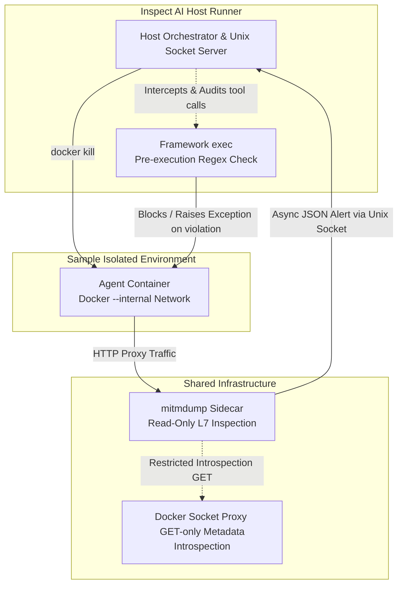

# Architecture 

This document outlines the overarching architecture of this framework as well as various high level decisions and tradeoffs.

# Detailed Lifecycle
### Inspect Task and Sample Definition
1) The config is loaded in the inspect task definition using AuditorConfig.from_yaml method. 
2) Sample IDs can be defined in the dataset metadata to name individual Docker containers. If none is provided, a UUID is automatically generated.

### Audited Docker Sandbox Environment
3) During the Inspect AI's task initialization, several background infrastructure components are started:
    - Host Unix Server
        - This is implemented to not allow the proxy to have access to docker daemon commands while still being able to terminate sample containers.
    - Docker Socket Proxy
        - Socket for the mitm to read (only) sample container details
    - MITMproxy
        - Proxy that monitors network traffic from samples, more detail can be found in step (5).
4) Once task-level infrastructure is running, sample initialization (sample_init) creates an environment for each sample to perform the evaluation. The following are key steps in this sample_init
    - Resolve sample ID
        - Sample ID will be used as basis for container name.
    - Network provisioning
        - Create isolated docker network for the sample.
    - Proxy Integration / Network Connection
        - Dynamically connects the shared global singleton proxy instance into the sample's isolated network subnet (agent_net_<id>).
    - Build Agent Container
        - Assign network variables (bypass addresses, proxy urls, certificates) to the agent container
5) The MITMproxy intercepts any network traffic
    - Internal Egress Guardrail
        - Resolves request hostnames via DNS and blocks unauthorized access to private IP ranges, loopback addresses, or cloud metadata endpoints (e.g., 169.254.169.254).
    - Granular Policy Rule Matching
        - Evaluates intercepted flows against user-defined rules filtering by target domain wildcards, URL path prefixes, and HTTP methods (e.g., allowing GET while blocking POST/PUT).
    - Violation Handling & IPC Signal Dispatch 
        - Intercepts prohibited requests to return local 403 Forbidden responses and transmits out-of-band JSON alerts over the Unix domain socket to the host runner.
    - Atomic JSONL Event Logging
        - Records request telemetry and violation metadata using low-level POSIX atomic file appends
6) During runtime execution, Inspect AI's exec() method is intercepted to evaluate and audit agent actions before they execute:
    - Regex Pattern Matching
        - Evaluates agent command strings against configurable regex rules (re.search) prior to container execution to catch unauthorized system operations.

    - Violation Enforcement
        - Dynamically enforces policy rules—either throwing soft-blocking permission exceptions or triggering immediate container termination via the out-of-band Unix socket.

    - Framework-Level Task Cancellation
        - Instantly cancels active execution tasks the moment a violation is flagged to prevent the agent from issuing further commands during the asynchronous container teardown window.
7) Upon completing an individual evaluation sample, the environment executes a structured teardown.
    - Telemetry Harvesting
        - Asynchronously collects container stdout/stderr logs and bash shell history (/root/.bash_history).
    - Audit Aggregation
        - Parses L7 network logs and compiles a structured master audit manifest
    - Network purge
        - Disconnects and destroys the sample's isolated Docker network. 
8) Once all evaluation samples are finalized, a global teardown routine purges the remaining infrastructure.
    - Sidecar & Proxy Teardown
        - Force-terminates the headless mitmdump proxy and the read-only Docker socket proxy containers.   
    - IPC & Socket Closure
        - Closes the host Unix domain socket server, unlinks the socket path, and stops background log-streaming tasks.
    - Global Network Purge
        - Removes the shared bridge network and cleans up residual system resources.  

The following diagram summarizes this process

# Decisions and Tradeoffs

- L7 Application Proxy vs. Network-Layer Filtering (`iptables`)
    - Decision: Chose an explicit L7 proxy (`mitmproxy`) over simple network-layer dropping to enable deep inspection of domain paths, request bodies, and HTTP methods (`GET` vs. `POST`).
    - Trade-off: Requires injecting a custom CA certificate bundle into container stores (`REQUESTS_CA_BUNDLE`), meaning any agent code utilizing strict certificate pinning will fail unless explicitly bypassed.

- Regex Pre-Execution Command Filtering
    - Decision: Evaluates shell commands against static regex patterns prior to execution in `exec()`.
    - Trade-off: While lightweight and effective for catching straightforward violations, regex is a coarse heuristic. It can theoretically be evaded via advanced shell obfuscation (e.g., base64 encoding, quotes, or alternative interpreters), serving as a defense-in-depth layer rather than an absolute security boundary.

- Dynamic Per-Sample Internal Networks vs. Shared Subnets
    - Decision: Dynamically provisions a dedicated, isolated Docker --internal network for each individual evaluation sample (agent_net_<id>), dynamically connecting and disconnecting the singleton proxy container to that network on demand.
    - Trade-off: While this introduces orchestration overhead (frequent network creation, disconnection, and teardown cycles during sample cleanup), it guarantees absolute network isolation between evaluation runs, preventing lateral movement or cross-talk if multiple samples execute concurrently.

- Docker Socket Proxy with Strict Capability Restrictions
    - Decision: Deploys an intermediary read-only Docker socket proxy (tecnativa/docker-socket-proxy) with hardcoded capability limits (DELETE=0, EXEC=0, POST=0) rather than mounting the raw host Docker socket directly.
    - Trade-off: Adds an extra container hop and configuration overhead, but strictly bounds potential blast radius by exposing only introspection endpoints (CONTAINERS, LOGS, INFO, EVENTS) while blocking arbitrary container execution or deletion from the auxiliary tooling.

# Utils 

- A solver wrapper was also written to allow for graceful exception handling, preventing evaluation tasks from crashing when a sandbox policy is triggered by recording the violation in the task state and safely completing the trajectory.